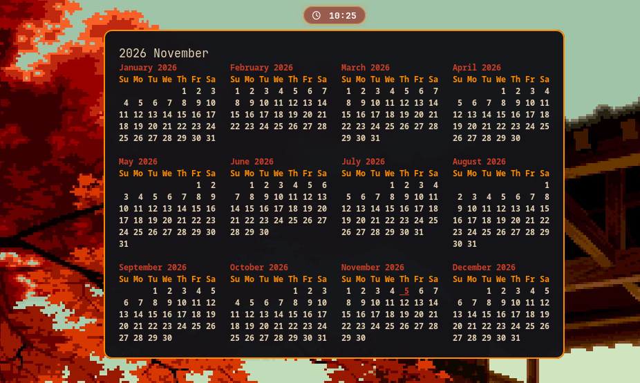
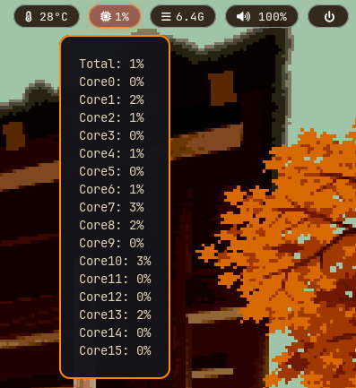
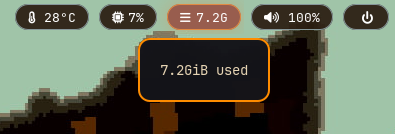
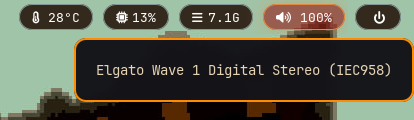
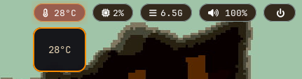

# ⛩ Shrine Waybar

A warm, shrine-themed Waybar setup for **KDE Plasma (Wayland)** on Bazzite. It has floating dark-wood pills, maple-red highlights, a live audio visualiser and themed rofi menus for launching apps and powering off.


| App launcher | Power menu |
|---|---|
|  |  |

| Year calendar (hover the clock) | Per-core CPU (hover CPU) |
|---|---|
|  |  |

| Temperature | RAM | Volume output |
|---|---|---|
|  |  |  |

## Features

- **Floating pill bar**: dark wood background, blue outline, and an orange glow on hover
- **App launcher**: a rofi menu with a shrine header image (󰀻 button)
- **Power menu**: shutdown, restart, sleep and logout in a matching rofi theme (⏻ button)
- **Now playing + visualiser**: the current track from any player (Spotify, browser, etc.) joined to a cava audio bar. Click to play/pause, scroll to skip. It hides itself when nothing is playing.
- **Year calendar tooltip**: hover the clock. Scroll to change month, right-click to switch view.
- **System stats**: temperature, CPU, RAM and volume. Click temp/RAM to open btop, click volume to open pavucontrol.
- **Quick launch**: Dolphin, Bazaar (⛩) and Brave

## Repo layout

```
shrine-waybar/
├── install.sh                  # Sets everything up (backs up your old configs first)
├── config/
│   ├── waybar/
│   │   ├── config.jsonc        # Bar layout and modules
│   │   ├── style.css           # Bar colours and pill styling
│   │   ├── mediaplayer.py      # Now-playing module (playerctl)
│   │   └── cava.sh             # Audio visualiser module
│   ├── rofi/
│   │   ├── launcher.sh         # Opens the app launcher
│   │   ├── power-menu.sh       # Opens the power menu
│   │   ├── app_launcher.rasi   # Launcher theme
│   │   ├── power.rasi          # Power menu theme
│   │   └── shrine_header.png   # Header image for both menus
│   └── autostart/
│       └── waybar.desktop      # Starts Waybar when you log into KDE
└── screenshots/
```

## Requirements

| Program | Used for |
|---|---|
| `waybar` | The bar itself |
| `rofi` | App launcher and power menu |
| `cava` | Audio visualiser |
| `playerctl` | Now-playing info and media controls |
| `kitty` + `btop` | Stats window when clicking temp/RAM |
| `pavucontrol` | Volume mixer when clicking volume |
| `python3` | Now-playing script (already on Bazzite) |
| JetBrainsMono Nerd Font | All the icons |

Optional apps the buttons open: Dolphin (comes with KDE), Bazaar (comes with Bazzite), [Brave](https://flathub.org/apps/com.brave.Browser) and [Evolution](https://flathub.org/apps/org.gnome.Evolution) for the calendar. Swap any of them for your own apps (see [Customising](#customising)).

## Install

### 1. Install the programs

Bazzite is an immutable (atomic) system, so system packages are layered with `rpm-ostree`, not `dnf`:

```bash
rpm-ostree install waybar rofi cava playerctl kitty btop pavucontrol
systemctl reboot
```

If it complains a package is already installed, remove that one from the list and run it again. The install script in step 4 also tells you exactly what's missing.

Flatpak apps for the buttons (optional):

```bash
flatpak install flathub com.brave.Browser org.gnome.Evolution
```

### 2. Install the font

```bash
mkdir -p ~/.local/share/fonts/JetBrainsMonoNerd
curl -fLo /tmp/JetBrainsMono.zip https://github.com/ryanoasis/nerd-fonts/releases/latest/download/JetBrainsMono.zip
unzip -o /tmp/JetBrainsMono.zip -d ~/.local/share/fonts/JetBrainsMonoNerd
fc-cache -f
```

### 3. Clone the repo

Keep it somewhere permanent, because your configs will point into this folder:

```bash
git clone https://github.com/Sevar-Naicker/shrine-waybar.git ~/shrine-waybar
cd ~/shrine-waybar
```

### 4. Run the installer

```bash
./install.sh
```

The installer:

1. Checks for missing programs and the font, and prints the command to install them
2. Moves any existing `~/.config/waybar`, `~/.config/rofi` and Waybar autostart entry into `~/.config-backup/`
3. Symlinks the repo's configs into `~/.config`
4. Restarts Waybar

Because the configs are symlinked, any edit you make in `~/shrine-waybar/config/` takes effect live, and you can commit it straight to git.

### 5. Hide the KDE panel

Otherwise you'll have two bars. Right-click the KDE panel and choose **Show Panel Configuration**. Then either:

- set **Visibility** to **Auto Hide**, to keep it as a backup, or
- click **Delete Panel**, to rely fully on Waybar

## Customising

- **Change the quick-launch apps:** edit the `custom/dolphin`, `custom/torii` and `custom/brave` blocks in `config/waybar/config.jsonc`. Change `on-click` to the command for your app. For a Flatpak, use `flatpak run <app id>`.
- **Change the terminal:** replace `kitty` in the `temperature` and `memory` blocks.
- **Change the calendar app:** edit `on-click` in the `clock` block.
- **Change colours:** the bar is in `config/waybar/style.css` and the menus are in the two `.rasi` files. The main palette:

| Colour | Hex | Where |
|---|---|---|
| Dark Wood | `#2A1D11` | Pill and menu backgrounds |
| Maple Red | `#CB3F27` / `#D3432B` | Visualiser, highlights, calendar |
| Gold | `#E18A42` | Hover borders and glow |
| Orange | `#FF8C00` | Tooltip frame, weekdays |
| Light Wood | `#E5D3B3` | Tooltip text |
| Sky Blue | `#86979A` / `#87CEEB` | Pill and menu outlines |

- **Change the header image:** replace `config/rofi/shrine_header.png` with any PNG.

After editing, reload the bar with:

```bash
pkill waybar; setsid -f waybar
```

## Uninstall

Remove the symlinks and restore your backup:

```bash
rm ~/.config/waybar ~/.config/rofi ~/.config/autostart/waybar.desktop
cp -r ~/.config-backup/shrine-waybar-<date>/* ~/.config/   # Only if you had configs before
```

## Troubleshooting

- **Icons show as boxes:** the Nerd Font isn't installed or the font cache is stale. Redo step 2 and log out and back in.
- **Visualiser or now-playing missing:** these hide when nothing is playing. Play something. If they still don't show, check that `cava` and `playerctl` are installed.
- **Two bars on login:** another autostart entry is also starting Waybar. Check `~/.config/autostart/`.
- **Waybar doesn't start on login:** check that `~/.config/autostart/waybar.desktop` exists, or add Waybar in **System Settings → Autostart**.

## License

[MIT](LICENSE)
