<div align="center">

# ⛩ Shrine Waybar

**A warm, autumn-shrine Waybar + rofi setup for KDE Plasma, on any KDE distro**

Floating dark-wood pills · a Quickshell dynamic island · maple-red highlights · themed menus


<br>

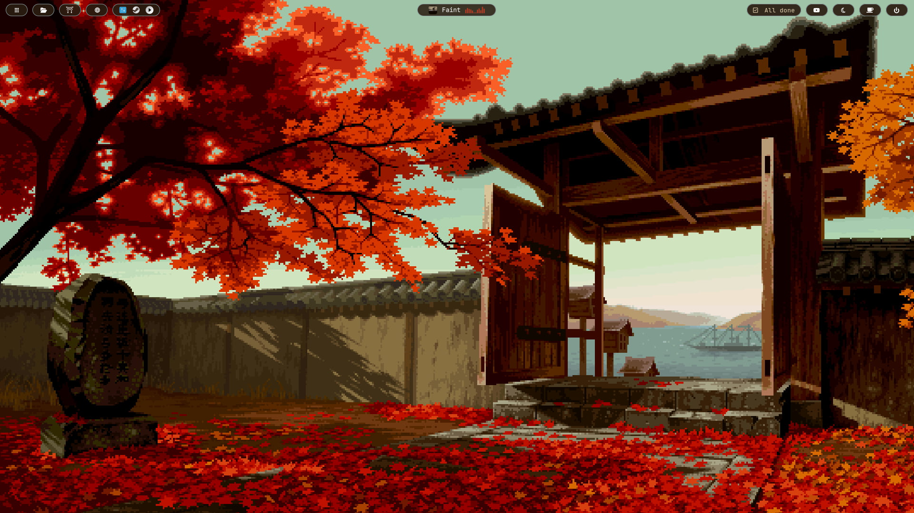

<br><br>

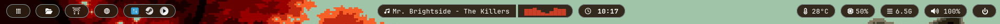

<br><br>

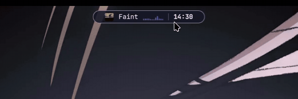

<sub>The dynamic island: drag or scroll to switch sections, click to open a card</sub>

</div>

<br>

## ✦ Gallery

<table>
  <tr>
    <th align="center">App launcher</th>
    <th align="center">Power menu</th>
  </tr>
  <tr>
    <td align="center">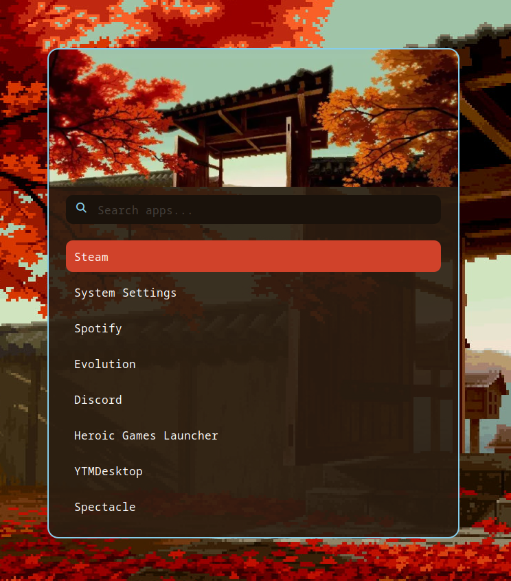</td>
    <td align="center">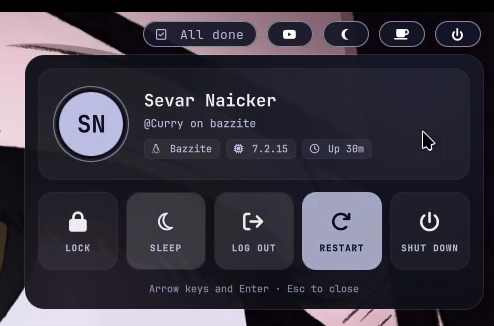</td>
  </tr>
</table>

### Dynamic island cards

<table>
  <tr>
    <th align="center">Music</th>
    <th align="center">Volume</th>
    <th align="center">Stats</th>
  </tr>
  <tr>
    <td align="center">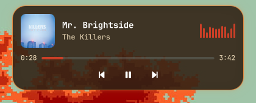</td>
    <td align="center">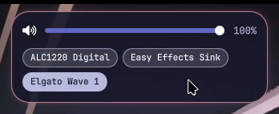</td>
    <td align="center">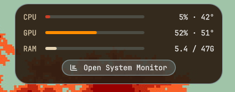</td>
  </tr>
  <tr>
    <th align="center">Downloads</th>
    <th align="center">Nextcloud sync</th>
    <th align="center">Pop-up <sub>(copied image)</sub></th>
  </tr>
  <tr>
    <td align="center">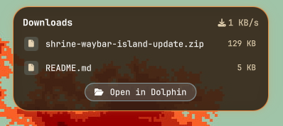</td>
    <td align="center">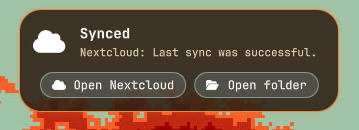</td>
    <td align="center">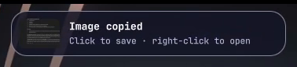</td>
  </tr>
  <tr>
    <th align="center">Updates waiting</th>
    <th align="center">Command finished <sub>(<code>island ujust update</code>)</sub></th>
    <th></th>
  </tr>
  <tr>
    <td align="center">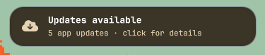</td>
    <td align="center">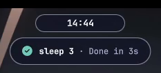</td>
    <td></td>
  </tr>
</table>

## ✦ Features

| | Feature | What it does |
|:-:|---|---|
| 🔍 | **App launcher** | Drops down from the launcher pill. Type to search your apps (most-used first), arrow keys and Enter to open, a sum like `24*7` to get the answer, or anything else to search the web |
| 🔌 | **Power menu** | Drops down from the power pill. Lock, sleep, log out, restart and shut down. The last three need a second click so you can't hit them by accident |
| 🏝 | **Dynamic island** | Replaces the centre of the bar. Clock, music with a cava visualiser, volume, stats, downloads and Nextcloud sync, plus pop-ups for screenshots, downloads and finished commands. See [Dynamic island](#-dynamic-island) |
| ☐ | **Today's task** | Your unfinished tasks from a plain text list, one at a time. Scroll to pick, click to tick it off, right-click to edit. With Nextcloud the list lives in `~/Nextcloud/Tasks.txt`, so you can edit it from your phone |
| 🎵 | **Music** | Opens your music app (YTMDesktop, Spotify, …) or YouTube Music in the browser. The icon matches the app |
| 🌙 | **Night light** | Toggles KDE's warm screen mode. Glows amber whenever the screen is warmed |
| ☕ | **Keep awake** | Click to stop the screen sleeping or locking. Turns maple red while on. Also in the control centre |
| 🎛 | **Control centre** | Wi-Fi, Bluetooth, night light and keep awake tiles, plus volume and microphone sliders. Right-click Wi-Fi or Bluetooth for KDE's settings |
| ⛩ | **Quick launch** | Dolphin, your app store (Bazaar or Discover) and your browser, one click each |

## ✦ Dynamic island

The centre of the bar is a [Quickshell](https://quickshell.org) island that matches the pills around it. Drag sideways or scroll on it to switch sections, and click to open a card.

| Section | Collapsed | Card |
|---|---|---|
| Clock | Time, date on hover | Large time and full date |
| Music | Album art, title, visualiser. Click the art to pause | Art, artist, seekable progress bar, controls |
| Volume | Level and percentage | Slider, mute, one-click output switching. Scroll to adjust |
| Stats | CPU %, CPU and GPU temperature | CPU, GPU and RAM bars, Open System Monitor |
| Downloads | Download speed | In-progress files, 5 recent files, Open in Dolphin |
| Sync | Nextcloud state | Nextcloud's status, open the client or folder |
| Updates | What's waiting, or "Restart to update" | System and Flatpak status, Update now, Restart. Works with each system's own package manager |

Music only shows while a player is open, Sync only while the Nextcloud client is running, and Updates only when something's waiting. CPU, GPU, RAM, temperatures and volume live in the island rather than on the bar.

It also pops out briefly for a new screenshot, a copied image, a finished download, new updates, a Nextcloud error, a volume change, or a command run with `island`:

```bash
island <any command>   # pops a tick or a cross, with how long it took
```

Everything lives in `config/quickshell/`. Its [README](config/quickshell/README.md) covers each file and fixes for common problems.

## ✦ Palette

| | Colour | Hex | Used for |
|:-:|---|---|---|
|  | Dark Wood | `#2A1D11` | Pill and menu backgrounds |
|  | Maple Red | `#CB3F27` | Visualiser, highlights, calendar |
|  | Gold | `#E18A42` | Hover borders and glow |
|  | Orange | `#FF8C00` | Tooltip frame, weekdays |
|  | Light Wood | `#E5D3B3` | Tooltip text |
|  | Sky Blue | `#87CEEB` | Pill and menu outlines |

## ✦ Supported systems

It needs **KDE Plasma 6 on Wayland**. Night light, the restart prompt and System Monitor are KDE features, so other desktops only get part of it. The installer works out which system it's on, prints the right install commands, and picks your app store, browser, music app and update command (see [Settings](#-settings)).

| System | Examples | Quickshell | Updates section checks |
|---|---|---|---|
| Fedora Atomic | Bazzite, Kinoite, Aurora | COPR | Downloaded system updates, Flatpak |
| Fedora | Fedora KDE | COPR | `dnf`, Flatpak |
| Arch | CachyOS, EndeavourOS, Manjaro, Arch | Official repos | `pacman` and AUR (with paru or yay), Flatpak |
| Debian | Kubuntu, KDE neon, Debian | [Build or install it yourself](https://quickshell.org/docs/v0.3.0/guide/install-setup) | `apt`, Flatpak |
| openSUSE | Tumbleweed, Leap | [Build or install it yourself](https://quickshell.org/docs/v0.3.0/guide/install-setup) | `zypper`, Flatpak |

Other systems still work. Their updates section just stays hidden, and **Update now** opens Discover.

## ✦ Requirements

| Program | Used for |
|---|---|
| `waybar` | The bar itself |
| `quickshell` | The dynamic island (see [Supported systems](#-supported-systems) for where to get it) |
| `wl-clipboard` | Copied-image pop-ups on the island |
| `rofi` | App launcher and power menu (version 2.0 or newer, or `rofi-wayland`) |
| `cava` | The island's audio visualiser |
| `python3` | The island's downloads watcher and the today's task pill (usually already installed) |
| `gdbus` | Night light, the restart prompt and logout (usually already installed, from `glib2`) |
| `pacman-contrib` | Arch-based systems only: lets the updates section count updates |
| A terminal | For the island's Update now button: kitty, konsole, alacritty, foot, wezterm or xterm |
| [JetBrainsMono Nerd Font](https://www.nerdfonts.com/font-downloads) | All the icons |

> [!NOTE]
> The buttons open apps the installer finds on your system: Bazaar or Discover for the store, Brave or your default browser, and YTMDesktop or Spotify for music (or YouTube Music in the browser). Change any of them in [Settings](#-settings).

## ✦ Install

### 1. Install the programs

Pick your system. The installer in step 4 also tells you exactly what's still missing.

<details open>
<summary><b>Bazzite and other Fedora Atomic systems</b></summary>

Packages are layered with `rpm-ostree`, not `dnf`. Quickshell comes from a COPR, so add it first:

```bash
sudo curl -Lo /etc/yum.repos.d/quickshell.repo \
  "https://copr.fedorainfracloud.org/coprs/errornointernet/quickshell/repo/fedora-$(rpm -E %fedora)/errornointernet-quickshell-fedora-$(rpm -E %fedora).repo"

rpm-ostree install waybar rofi cava quickshell wl-clipboard
systemctl reboot
```

If it complains a package is already installed, remove that one from the list and run it again.

</details>

<details>
<summary><b>Fedora KDE</b></summary>

```bash
sudo dnf copr enable errornointernet/quickshell
sudo dnf install waybar rofi cava quickshell wl-clipboard
```

</details>

<details>
<summary><b>CachyOS, EndeavourOS, Manjaro and Arch</b></summary>

Quickshell is in the official repos:

```bash
sudo pacman -S --needed waybar rofi cava quickshell wl-clipboard pacman-contrib
```

</details>

<details>
<summary><b>Kubuntu, KDE neon and Debian</b></summary>

```bash
sudo apt install waybar rofi cava wl-clipboard
```

Quickshell isn't in the Debian or Ubuntu repos. Install it using the [Quickshell install guide](https://quickshell.org/docs/v0.3.0/guide/install-setup).

</details>

<details>
<summary><b>openSUSE Tumbleweed and Leap</b></summary>

```bash
sudo zypper install waybar rofi cava wl-clipboard
```

Quickshell isn't in the main openSUSE repos. Install it using the [Quickshell install guide](https://quickshell.org/docs/v0.3.0/guide/install-setup).

</details>

Optional apps for the buttons, on any system with Flatpak:

```bash
flatpak install flathub com.brave.Browser              # Browser pill
flatpak install flathub app.ytmdesktop.ytmdesktop      # Music pill
flatpak install flathub org.gnome.Evolution            # Only for the optional Waybar clock module
```

### 2. Install the font

```bash
mkdir -p ~/.local/share/fonts/JetBrainsMonoNerd
curl -fLo /tmp/JetBrainsMono.zip https://github.com/ryanoasis/nerd-fonts/releases/latest/download/JetBrainsMono.zip
unzip -o /tmp/JetBrainsMono.zip -d ~/.local/share/fonts/JetBrainsMonoNerd
fc-cache -f
```

### 3. Clone the repo

```bash
git clone https://github.com/Sevar-Naicker/Waybar.git ~/shrine-waybar
cd ~/shrine-waybar
```

> [!IMPORTANT]
> Keep this folder where it is. Your configs will point into it, so moving or deleting it breaks the bar.

### 4. Run the installer

```bash
./install.sh
```

The installer:

1. Works out which system you're on
2. Checks for missing programs and the font, and prints the command to install them on your system
3. Moves any existing `~/.config/waybar`, `~/.config/rofi`, `~/.config/quickshell`, `~/.config/shrine-waybar` and autostart entries into `~/.config-backup/`
4. Symlinks the repo's configs into `~/.config`
5. Creates your `shrine.conf` with the apps and folders it found, and shows them (see [Settings](#-settings))
6. Adds the `island` command to `~/.bashrc`
7. Restarts Waybar, then the dynamic island

> [!TIP]
> Because the configs are symlinked, any edit in `~/shrine-waybar/config/` takes effect live, and you can commit it straight to git.

### 5. Hide the KDE panel

Otherwise you'll have two bars. Right-click the KDE panel and choose **Show Panel Configuration**, then either:

- set **Visibility** to **Auto Hide**, to keep it as a backup, or
- click **Delete Panel**, to rely fully on Waybar

## ✦ Settings

Your own choices live in `~/.config/shrine-waybar/shrine.conf`. The installer fills it in for your system. It's yours, so it's never committed to git or overwritten by an update. Change a line and reload Waybar, or delete a line to go back to the automatic choice.

| Setting | What it controls | Example |
|---|---|---|
| `SHRINE_SYSTEM` | Which package manager the updates section checks | `atomic`, `fedora`, `arch`, `debian`, `opensuse` |
| `SHRINE_UPDATE_COMMAND` | What the island's Update now button runs (empty opens Discover) | `ujust update`, `paru -Syu` |
| `SHRINE_TERMINAL` | Terminal for Update now | `kitty`, `konsole` |
| `SHRINE_STORE_APP` | Torii pill | `io.github.kolunmi.Bazaar`, `org.kde.discover` |
| `SHRINE_BROWSER_APP` | Globe pill | `com.brave.Browser`, `firefox` |
| `SHRINE_MUSIC_APP` | Music pill (empty opens `SHRINE_MUSIC_URL` in the browser) | `app.ytmdesktop.ytmdesktop`, `com.spotify.Client` |
| `SHRINE_TASKS_FILE` | Today's task list | `$HOME/Nextcloud/Tasks.txt` |
| `SHRINE_NEXTCLOUD_DIR` | Folder the sync card opens | `$HOME/Nextcloud` |
| `SHRINE_DOWNLOADS_DIR` | Folder the downloads section watches | `$HOME/Downloads` |
| `SHRINE_SCREENSHOTS_DIR` | Folder screenshots pop up from, and copied images save to | `$HOME/Pictures/Screenshots` |

App settings use the app's ID, which is its `.desktop` file name without `.desktop`. `ls /usr/share/applications ~/.local/share/applications /var/lib/flatpak/exports/share/applications` lists them.

```bash
~/.config/shrine-waybar/settings.sh --print        # see every setting, including automatic ones
~/.config/shrine-waybar/settings.sh --write-conf   # recreate shrine.conf after deleting it
```

## ✦ Customising

| To change | Edit |
|---|---|
| Store, browser and music apps, the update command, the terminal, and the task, downloads and screenshots folders | `~/.config/shrine-waybar/shrine.conf` (see [Settings](#-settings)) |
| Which pills are on the bar | `modules-left` and `modules-right` in `config/waybar/config.jsonc` |
| Calendar app | `on-click` in the `clock` block (only used if you put `clock` back in `modules-center`) |
| Bar colours | `config/waybar/style.css` |
| Menu colours | `config/rofi/app_launcher.rasi` and `config/rofi/power.rasi` |
| Menu header image | Replace `config/rofi/shrine_header.png` with any PNG |
| Island sections and their order | `sectionOrder` in `config/quickshell/shell.qml` |
| Island colours | The hex colours in `config/quickshell/shell.qml` (same palette as above) |

After editing, reload the bar:

```bash
pkill waybar; setsid -f waybar
```

The island reloads by itself whenever `shell.qml` is saved.

<details>
<summary><b>📁 Repo layout</b></summary>

```
shrine-waybar/
├── install.sh                  # Sets everything up for your system (backs up your old configs first)
├── config/
│   ├── shrine-waybar/
│   │   ├── settings.sh         # Works out your system and default apps, reads shrine.conf
│   │   ├── run.sh              # What every button runs (opens the right app on any system)
│   │   └── shrine.conf         # Your own choices (made by the installer, not in git)
│   ├── waybar/
│   │   ├── config.jsonc        # Bar layout and modules
│   │   ├── style.css           # Bar colours and pill styling
│   │   ├── tasks.py            # Today's task pill
│   │   ├── night-light.sh      # Night light pill and toggle
│   │   ├── mediaplayer.py      # Old now-playing module (not on the bar now, kept as an option)
│   │   └── cava.sh             # Old visualiser module (not on the bar now, kept as an option)
│   ├── rofi/
│   │   ├── launcher.sh         # Opens the app launcher
│   │   ├── power-menu.sh       # Opens the power menu
│   │   ├── app_launcher.rasi   # Launcher theme
│   │   ├── power.rasi          # Power menu theme
│   │   └── shrine_header.png   # Header image for both menus
│   ├── quickshell/
│   │   ├── shell.qml           # The dynamic island
│   │   ├── Theme.qml           # Colours and font the menus share
│   │   ├── MenuWindow.qml      # The drop-down window every menu opens in
│   │   ├── Launcher.qml        # App launcher
│   │   ├── Calculator.js       # The launcher's calculator
│   │   ├── PowerMenu.qml       # Power menu
│   │   ├── ControlCentre.qml   # Control centre
│   │   ├── controls.sh         # Wi-Fi, Bluetooth and night light status for the control centre
│   │   ├── ShellState.qml      # Keep awake, shared by the coffee pill and control centre
│   │   ├── cava.conf           # Island visualiser settings
│   │   ├── stats.sh            # CPU, GPU and RAM readings
│   │   ├── updates.sh          # Waiting updates, for each system's package manager
│   │   ├── downloads.py        # Downloads, screenshots and download speed
│   │   ├── clipboard.sh        # Watches for copied images
│   │   ├── clipboard-handler.sh
│   │   ├── island-command.sh   # The "island" terminal command
│   │   └── README.md           # Island details and troubleshooting
│   └── autostart/
│       ├── waybar.desktop      # Starts Waybar when you log into KDE
│       └── dynamic-island.desktop  # Starts the island
└── screenshots/
```

</details>

<details>
<summary><b>🛠 Troubleshooting</b></summary>

- **Icons show as boxes:** the Nerd Font isn't installed or the font cache is stale. Redo step 2, then log out and back in.
- **Music section missing from the island:** it only appears while a media player is open. Play something.
- **Island visualiser bars stay flat:** check that `cava` runs on its own in a terminal.
- **Two bars on login:** another autostart entry is also starting Waybar. Check `~/.config/autostart/`.
- **Waybar doesn't start on login:** check that `~/.config/autostart/waybar.desktop` exists, or add Waybar in **System Settings → Autostart**.
- **The island shows but can't be clicked:** Waybar is sitting on top of it. Check that `config/waybar/config.jsonc` has `"layer": "bottom"`, then reload Waybar.
- **The island doesn't appear:** run `qs log` to see what it printed, or start it by hand with `setsid -f qs`.
- **Reloading Waybar closes an app:** that app was opened before the `setsid -f` launch commands were added. Reopen it and it won't happen again.
- **A button opens the wrong app, or nothing:** check the matching setting in `~/.config/shrine-waybar/shrine.conf`. `settings.sh --print` shows what's being used.
- **Update now opens Discover instead of a terminal:** `SHRINE_UPDATE_COMMAND` is empty, or no supported terminal was found. Set them in `shrine.conf`.
- **Updates section never shows on Arch:** install `pacman-contrib`, which provides `checkupdates`.
- **Logout takes a few seconds:** that's KDE closing your apps and saving your session, which is normal.

</details>

<details>
<summary><b>↩ Uninstall</b></summary>

Remove the symlinks and restore your backup:

```bash
rm ~/.config/waybar ~/.config/rofi ~/.config/quickshell ~/.config/shrine-waybar
rm ~/.config/autostart/waybar.desktop ~/.config/autostart/dynamic-island.desktop
cp -r ~/.config-backup/shrine-waybar-<date>/* ~/.config/   # Only if you had configs before
```

Then delete the `island-command.sh` line the installer added to `~/.bashrc`.

</details>

---

<div align="center">

Made by [Sevar Naicker](https://github.com/Sevar-Naicker) · Released under the [MIT License](LICENSE)

</div>
